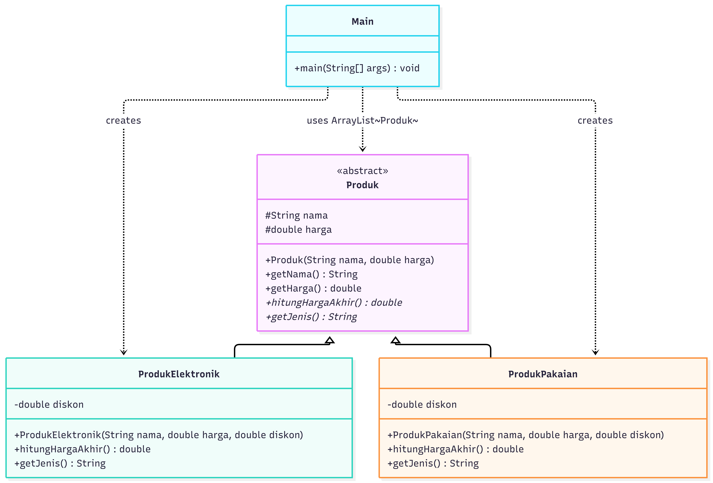

# Program Review

## 1. Abstract Class

An abstract class is a class declared using the `abstract` keyword. It provides a common structure for related classes and can contain abstract methods that must be implemented by its concrete subclasses.

In the E-Commerce Product Management System, `Produk` is an abstract class that defines common attributes and methods for different product types.

```java
public abstract class Produk {
    protected String nama;
    protected double harga;

    public Produk(String nama, double harga) {
        this.nama = nama;
        this.harga = harga;
    }

    public String getNama() {
        return nama;
    }

    public double getHarga() {
        return harga;
    }

    public abstract double hitungHargaAkhir();
    public abstract String getJenis();
}
```

The `Produk` class cannot be instantiated directly. Its subclasses must implement `hitungHargaAkhir()` and `getJenis()`.

## 2. Arrays

An array is a data structure that stores multiple elements of the same type in a fixed-size collection. It can store primitive values or references to objects.

For example, an array can store several product prices.

```java
double[] prices = {1000000, 200000, 500000};

for (int i = 0; i < prices.length; i++) {
    System.out.println(prices[i]);
}
```

The `prices` array contains three values. The `for` loop accesses each element using its index.

An array has a fixed length after it is created.

## 3. ArrayList

An `ArrayList` is a resizable collection in Java that can store objects and dynamically grow or shrink as elements are added or removed.

In the E-Commerce Product Management System, `ArrayList` stores product objects of different subclasses.

```java
import java.util.ArrayList;

ArrayList<Produk> daftarProduk = new ArrayList<>();

daftarProduk.add(
    new ProdukElektronik("Headphone", 1000000, 20)
);

daftarProduk.add(
    new ProdukPakaian("Kaos", 200000, 40)
);
```

The `ArrayList<Produk>` declaration allows the collection to store `ProdukElektronik` and `ProdukPakaian` objects because both classes inherit from `Produk`.

The program iterates through the collection to display product information and calculate final prices.

```java
for (Produk p : daftarProduk) {
    System.out.println(p.getNama());
    System.out.println(p.hitungHargaAkhir());
}
```

Unlike a regular array, an `ArrayList` can dynamically adjust its size.

## 4. Scanner

`Scanner` is a Java utility class used to receive input from sources such as the keyboard.

In the E-Commerce Product Management System, `Scanner` receives the menu selection, product name, price, and discount.

```java
import java.util.Scanner;

Scanner input = new Scanner(System.in);

System.out.print("Nama produk: ");
String nama = input.nextLine();

System.out.print("Harga produk: Rp");
double harga = input.nextDouble();

System.out.print("Diskon (%): ");
double diskon = input.nextDouble();
```

The `nextLine()` method reads a line of text, while `nextDouble()` reads a numeric value of type `double`.

These methods allow users to enter product information interactively through the console.

The program also validates the input to ensure that the price is positive and the discount is between 0 and 100 percent.

## 5. Inheritance

Inheritance allows a class to acquire accessible attributes and methods from another class. In Java, it is implemented using the `extends` keyword.

In the E-Commerce Product Management System, `ProdukElektronik` and `ProdukPakaian` inherit from the abstract class `Produk`.

```java
public class ProdukElektronik extends Produk {
    private double diskon;

    public ProdukElektronik(
        String nama,
        double harga,
        double diskon
    ) {
        super(nama, harga);
        this.diskon = diskon;
    }
}
```

The `ProdukElektronik` class inherits the `nama` and `harga` attributes from `Produk`. The `super(nama, harga)` statement calls the parent class constructor to initialize these attributes.

The `ProdukPakaian` class follows the same inheritance relationship.

Inheritance promotes code reuse and establishes a common structure for related product classes.

## 6. Polymorphism

Polymorphism allows objects of different classes to provide different implementations of the same method. In Java, runtime polymorphism can be achieved through method overriding.

In the E-Commerce Product Management System, `ProdukElektronik` and `ProdukPakaian` override the `hitungHargaAkhir()` method to calculate final prices using different discount limits.

**ProdukElektronik:**

```java
@Override
public double hitungHargaAkhir() {
    double diskonAktual = Math.min(diskon, 15);
    return harga - (harga * diskonAktual / 100);
}
```

Electronic products have a maximum applicable discount of 15 percent.

**ProdukPakaian:**

```java
@Override
public double hitungHargaAkhir() {
    double diskonAktual = Math.min(diskon, 30);
    return harga - (harga * diskonAktual / 100);
}
```

Clothing products have a maximum applicable discount of 30 percent.

Polymorphism is demonstrated when the program calls `hitungHargaAkhir()` through a parent-class reference.

```java
for (Produk p : daftarProduk) {
    System.out.println(p.hitungHargaAkhir());
}
```

Although the reference variable `p` has the type `Produk`, Java executes the overridden method corresponding to the actual object type.

For example, an electronic product with a price of Rp1,000,000 and an entered discount of 20 percent receives the maximum applicable discount of 15 percent, resulting in a final price of Rp850,000.

A clothing product with a price of Rp200,000 and an entered discount of 40 percent receives the maximum applicable discount of 30 percent, resulting in a final price of Rp140,000.

This demonstrates how polymorphism allows different product types to apply their own pricing rules through a common method.

## Conclusion

The E-Commerce Product Management System demonstrates several Java programming concepts. Abstract classes provide a common structure for products, arrays store elements in a fixed-size collection, `ArrayList` manages a dynamic collection of products, `Scanner` receives user input, and inheritance enables code reuse.

Finally, polymorphism allows different product types to apply different discount limits through the shared `hitungHargaAkhir()` method. Together, these concepts support a modular and extensible object-oriented application.


## Class Diagram




